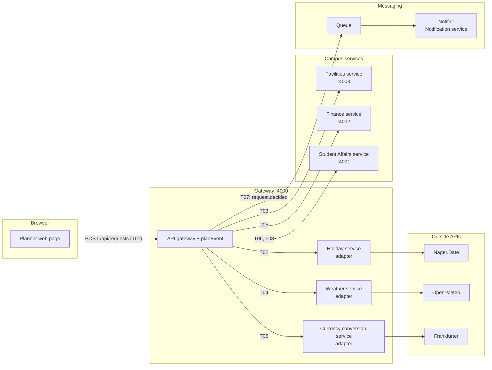
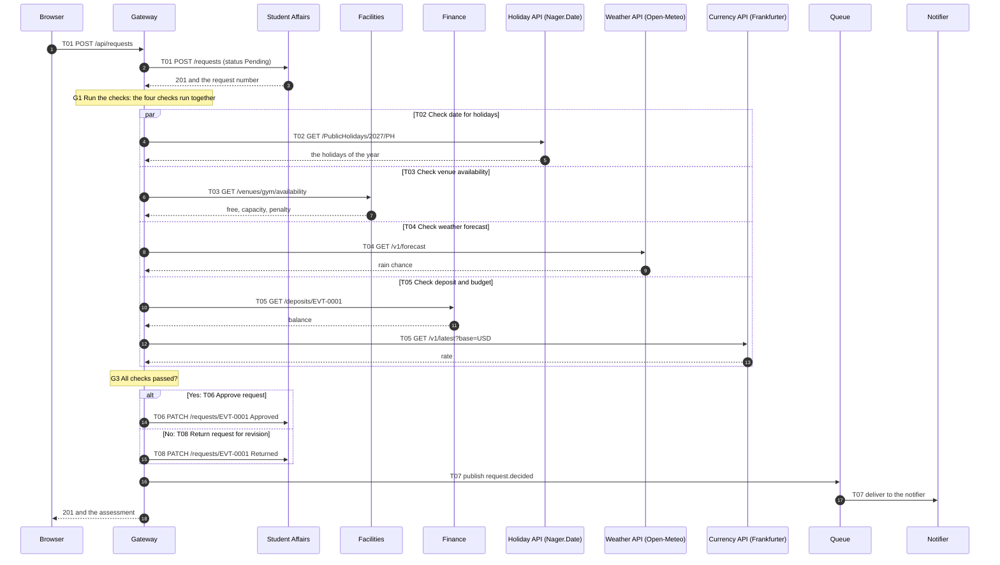
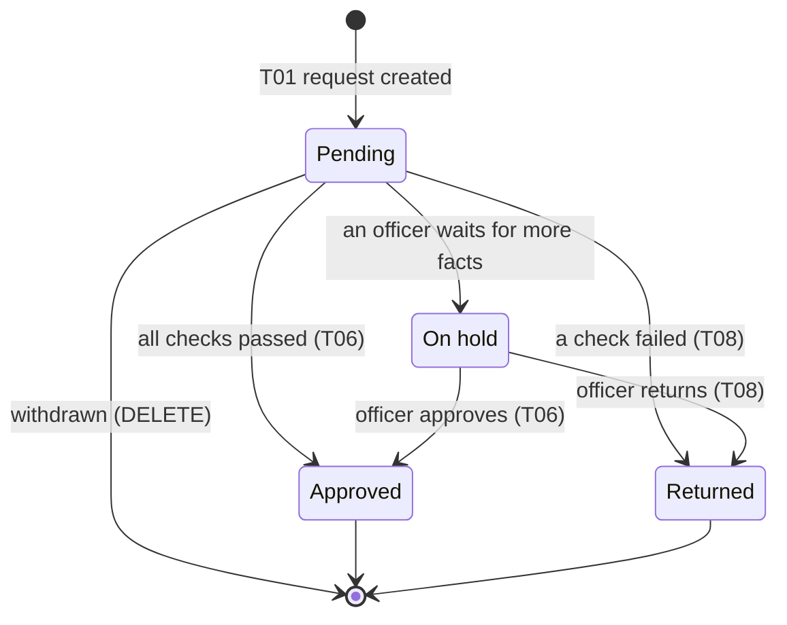
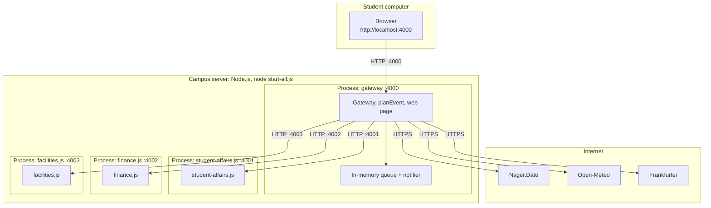

# Architecture of the Campus Event Planner

> Generated by `node generate-diagrams.js` from the project data. Do not edit by hand: change the data and generate again.

## 1. Purpose

Decide quickly and fairly whether a student organization may hold an event, using the rules of the campus and facts from the campus systems and free public APIs.

This document is a map: it tells the team, and the next person who joins, which parts exist, how they talk to each other, and why they were chosen.

## 2. Context

- **Users:** an organizer submits an event request in a web page; a Student Affairs officer handles the cases the planner cannot decide.
- **Campus systems:** Facilities service, Finance service, Notification service, Student Affairs service.
- **Outside systems:** Nager.Date, Open-Meteo, Frankfurter (free, no key).
- **Process:** the BPMN process `docs/process.bpmn`, tasks T01 to T08; every diagram below uses its task ids.

## 3. Views

### 3.1 Components

Question it answers: *Which parts does the system have, and which part is connected to which?*



### 3.2 One request, step by step

Question it answers: *In which order do the parts send messages to each other?*



### 3.3 The life of a request

Question it answers: *Which states does one thing go through, and what moves it from one to the next?*



### 3.4 Where it runs

Question it answers: *On which machines and processes does the software run, and on which ports?*



## 4. Components

| Component | Responsibility | Port or place | Tasks |
|---|---|---|---|
| Planner web page | A form for the organizer and a card with the decision and the reasons (`web/`). | served by the gateway | T01 |
| Gateway and planner | One entry point: routes calls, runs the process in `planEvent`, answers `POST /api/requests`. | port 4000 | T01 to T08 |
| Holiday service | Tells whether a date is a public holiday in a country. | adapter in the gateway, calls Nager.Date | T02 |
| Facilities service | Venues, their capacity and penalties, and their reservations. | port 4003 | T03 |
| Weather service | The forecast for a date at a place: rain chance and highest temperature. | adapter in the gateway, calls Open-Meteo | T04 |
| Finance service | Deposits: how much of a deposit is still unpaid, and payments. | port 4002 | T05 |
| Currency conversion service | Converts an amount in another currency to Philippine pesos. | adapter in the gateway, calls Frankfurter | T05 |
| Notification service | Sends a notice about a decision to the organizer. | in the gateway process (queue + notifier) | T07 |
| Student Affairs service | Event requests: create, read, list and change the status of a request. | port 4001 | T06, T08 |
| Queue | Carries `request.decided` from the planner to the notifier; retries and keeps dead letters. | in the gateway process | T07 |
| Nager.Date | Outside API behind the holiday service. | internet, HTTPS | T02 |
| Open-Meteo | Outside API behind the weather service. | internet, HTTPS | T04 |
| Frankfurter | Outside API behind the currency conversion service. | internet, HTTPS | T05 |

## 5. Decisions

**D1 One gateway in front of the services.** The strategy scored highest in episode 6 is **Gateway + queue for notifications** (99 of 115 points, 86 percent; next: Hub-and-spoke (API gateway), 94). The gateway is the single place for routing, timeouts and the planner.

**D2 REST and JSON between all parts.** One style everywhere (see `docs/standards.json`), so a service can be replaced without changing its callers.

**D3 A queue for the notice.** The organizer's e-mail is sent after the answer; a slow mail server never slows the decision (T07).

**D4 Adapters protect the outside APIs.** Cache, retry and a circuit breaker sit between the planner and Nager.Date, Open-Meteo and Frankfurter.

**D5 Diagrams are text, generated from data.** `generate-diagrams.js` writes the diagrams from `services.json`, `process.bpmn`, `ports.js` and the service code, and the checkers fail when one drifts.

## 6. Quality attributes

| NFR | Quality | Target | How the architecture meets it |
|---|---|---|---|
| NFR-01 | performance | at most 3000 ms | The four checks run at the same time (`Promise.all` in `planEvent`), and outside answers are cached. |
| NFR-02 | availability | at least 100 percent | An outside API that does not answer makes its check `unknown`, so the planner still answers with `needs-review`. |
| NFR-03 | reliability | at most 3 attempts | Retry with backoff and a circuit breaker on every outside call; the queue retries a failing notification. |
| NFR-04 | security | exactly 0 findings | One entry point (the gateway); every service validates its input; no keys are needed or stored. |
| NFR-05 | usability | at least 100 percent | The page shows a decision with a color and a word, and the reasons are full sentences. |
| NFR-06 | interoperability | at least 100 percent | Every service speaks REST and JSON and has an OpenAPI contract, so any client can call it. |
| NFR-07 | maintainability | at least 100 percent | Small services with one owner each, one gateway, and diagrams generated from the project data. |
| NFR-08 | capacity | at least 20 requests per minute | The gateway and the services keep no session, so they can run several times; the in-memory queue is the first limit. |

## 7. How to view the diagrams

- **GitHub** draws every ```` ```mermaid ```` block when you open this file.
- **Visual Studio Code:** install a Mermaid extension (for example *Markdown Preview Mermaid Support*) and open the Markdown preview.
- **mermaid.live:** paste the text of one diagram into the editor to see it and export a PNG or SVG.

## 8. Which diagram answers which question

| Diagram | Question | In this project |
|---|---|---|
| Use case diagram | Who uses the system, and for which goals? | Organizer: submit a request. Officer: decide a request. Written first, before the services are chosen. |
| Class diagram | Which things (data) exist, and how are they related? | Request, Venue and Deposit with their fields. Useful inside one service, not between services. |
| Component diagram | Which parts does the system have, and which part is connected to which? | Page, gateway, three campus services, queue, notifier and the three outside APIs. |
| Sequence diagram | In which order do the parts send messages to each other? | One call of POST /api/requests, from the page to the answer, with the four parallel checks. |
| State diagram | Which states does one thing go through, and what moves it from one to the next? | The life of an event request: Pending, Approved, Returned, On hold. |
| Activity diagram | Which steps does a process have, and where does it split or join? | Already drawn as the BPMN process of episode 2, so no second diagram is needed. |
| Deployment diagram | On which machines and processes does the software run, and on which ports? | Browser, one Node.js process per service and the gateway, and the internet. |
